  

  

  
  
  
  

## 👋 Hey there, I'm Pumpkin

I work on **machine vision** — teaching cameras to reliably see objects and motion: detection, tracking and real-time deployment. On the side I write Python quant scanners and run agent experiments on BNB Chain.

**Machine Vision** · object detection & tracking, real-time vision, edge deployment 
**Embedded & Robotics** · C, target tracking & autonomous motion control 
**Markets** · Python, long-side scanning with [`longscan`](https://github.com/PitoLis/longscan) 
**Web3** · BNB Chain, agent-only launchpads ([gang.fun](https://gang.fun)), ZK basics with Aleo

### 🚀 What I'm up to

- [x] Built a **[vision-based active following system](https://github.com/PitoLis/vision-based-active-following-system)** — detection, tracking and autonomous motion control, written in C ⭐ 34
- [x] Running a local BSC trading desk + Four.meme sniper monitor ([agenticwallet-desk](https://github.com/PitoLis/agenticwallet-desk))
- [ ] Exploring agent-only launchpads on BNB Chain ([gang-launchpad](https://github.com/PitoLis/gang-launchpad) · [gang.fun](https://gang.fun))
- [ ] Learning zero-knowledge & privacy with Aleo

### 📌 Pinned work

  
  

### 📊 GitHub stats

  
  

  

---

  

Black & gold flavored ✨ · hand-decorated profile README

